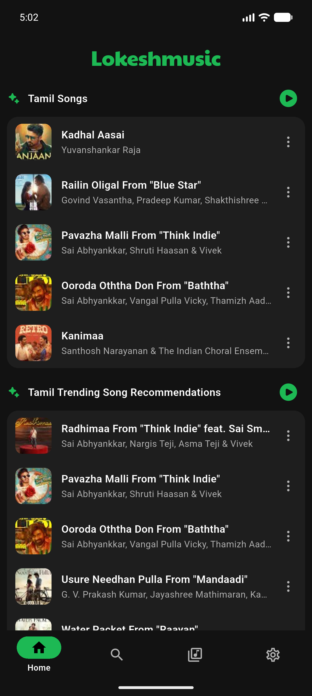
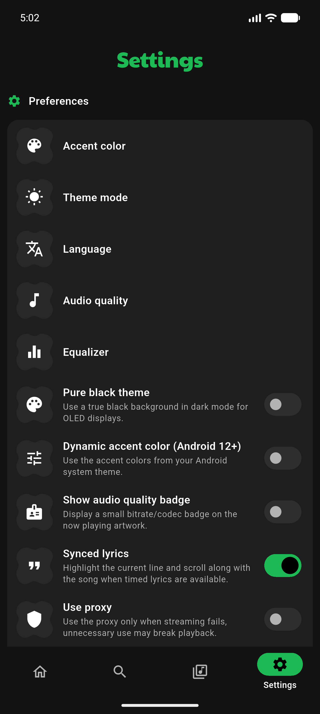

<div align="center">


# LokeshMusic

**A free, open-source music streaming app for Android.**

Dark, fast, and built with Flutter.

[**Download the latest APK**](https://github.com/lokesh12dev/Lokeshmusic/releases/latest) · [Report an issue](https://github.com/lokesh12dev/Lokeshmusic/issues) · [Source code](https://github.com/lokesh12dev/Lokeshmusic)

</div>

---

## Download

| Build | Download |
| --- | --- |
| **Universal APK** (recommended) | [LokeshMusic latest release](https://github.com/lokesh12dev/Lokeshmusic/releases/latest) |
| **64-bit ARM APK** (smaller) | Available on the same release page |

Every release also publishes a `SHA256SUMS.txt` file so you can verify your
download.

> Clicking an APK link downloads the installer. Android always asks for your
> approval before installing an app; no website can silently install software
> on your device.

### Install

1. Download `LokeshMusic-v*-universal.apk` on your Android device.
2. Open the downloaded file.
3. If Android asks, allow installation from this source.
4. Install and open LokeshMusic.

LokeshMusic is free. There is no subscription, no paid APK, and no account
required to use the app.

### Verify your download

Each release publishes `SHA256SUMS.txt`. To verify an APK on Linux:

```bash
sha256sum -c SHA256SUMS.txt
```

On macOS use `shasum -a 256 -c SHA256SUMS.txt`. The release APKs are signed
with the LokeshMusic release key (certificate SHA-256:
`f50a6c710f98ec187ebc50424bc1ec13f656f4ab741ebda9a943b7a21bbddfa7`).

## Screenshots

<div align="center">


</div>

## Features

- **Spotify-inspired dark interface** with Material 3, an accent-green palette,
  and responsive layouts for phones, tablets, and desktop widths.
- **Streaming playback** with a single coordinated audio engine, background
  playback, notification and lock-screen controls, audio-focus handling, and
  Android Auto browsing.
- **Search and discovery** across songs, artists, albums, and playlists.
- **Library management** with playlists, folders, favorites, radio stations,
  listening history, and listening recaps.
- **Offline listening** with downloads and offline mode.
- **Lyrics**, including timed lyrics, plus SponsorBlock support.
- **Personalization** with theme modes, dynamic color, equalizer, and language
  settings.
- **Import and export**: back up app data or import a Spotify playlist CSV and
  match tracks through search.

## Supported Android versions

- **Minimum:** Android 7.0 (API 24)
- **Target:** Android 16 (API 36)
- **Package ID:** `com.lokesh.lokeshmusic`

## Architecture

LokeshMusic is a **local-first Flutter application**. It does not ship a
bundled server, database credentials, or proprietary music catalog.

```
lib/
├── constants/        App-wide constants and provider configuration
├── database/         Hive-backed local storage (albums, playlists, radio)
├── models/           Typed data models
├── screens/          Feature screens and navigation shells
├── services/         Playback, search, downloads, settings, routing
├── theme/            Design tokens and Material 3 themes
├── utilities/        Shared helpers
├── widgets/          Reusable UI components (mobile + desktop shell)
└── localization/     Generated translations
```

- **State and storage:** Hive boxes for settings, user data, cache, and library
  data. No remote account or cloud database is required.
- **Playback:** `just_audio` with `audio_service` for one persistent media
  session, notifications, lock-screen controls, and background playback.
- **Routing:** `go_router` with a `StatefulShellRoute` for tab state, plus a
  desktop shell at widths ≥ 900 px.
- **Networking:** metadata and audio stream resolution through public
  YouTube/YouTube Music extraction endpoints. There is no private API key in
  the app.

### Performance notes

- Hive boxes are opened once during startup and reused.
- App-directory resolution overlaps audio-service initialization, and theme
  construction is reused for light and dark themes.
- Dynamic color is only queried when the user enables the system-color option.
- Artwork is loaded lazily and cached through `cached_network_image`.
- Lists use lazy builders; search input is debounced.
- The player is a single long-lived `AudioPlayer` inside the audio handler;
  playback state is exposed through streams so the UI does not poll.
- Release builds use R8/proguard optimization and resource shrinking is
  disabled only where required by Flutter plugins.

Measured on the Pixel 8 Pro API 37 emulator (software GL renderer), cold start
improved from ~8.5 s to ~5.2 s after these changes. Release APK sizes are
approximately 31 MB (universal) and 13 MB (arm64-v8a). Real devices with
hardware rendering start substantially faster.

## Build from source

Requirements: Flutter 3.47.7+ (stable), Dart 3.13+, Java 17, Android SDK 36.

```bash
git clone https://github.com/lokesh12dev/Lokeshmusic.git
cd Lokeshmusic
flutter pub get
flutter analyze --no-fatal-infos
flutter test
flutter build apk --release --flavor github
```

The universal APK is written to
`build/app/outputs/flutter-apk/app-github-release.apk`.

### Flavors

| Flavor | Application ID | Purpose |
| --- | --- | --- |
| `github` | `com.lokesh.lokeshmusic` | Direct APK / GitHub Releases |
| `fdroid` | `com.lokesh.lokeshmusic.fdroid` | F-Droid-compatible build |

## Release signing

Release builds are signed when `android/key.properties` exists:

```properties
storeFile=key.jks
storePassword=********
keyAlias=lokeshmusic
keyPassword=********
```

The keystore is expected at `android/app/key.jks`. **Never commit the keystore
or `key.properties`** — both are ignored by `.gitignore`.

Without `key.properties`, a release build falls back to debug signing so it can
still be installed for testing. Such an APK must not be published as an
official release.

### Automated releases

`.github/workflows/android-release.yml` builds, verifies, checksums, and
publishes the APKs when a version tag is pushed:

```bash
git tag v10.6.0
git push origin v10.6.0
```

Configure these repository secrets first:

| Secret | Value |
| --- | --- |
| `KEYSTORE_BASE64` | `base64 < android/app/key.jks` |
| `KEYSTORE_PASSWORD` | Keystore password |
| `KEY_ALIAS` | `lokeshmusic` |
| `KEY_PASSWORD` | Key password |

Back up the keystore and passwords in a secure location. Losing them prevents
signing updates that existing installs can accept.

## Privacy

- No account is required and no analytics SDK is bundled.
- Settings, playlists, and history are stored locally on your device.
- Network requests are made only to resolve and stream music, fetch artwork,
  and check for updates.
- Data you export or back up stays under your control.

## Legal and limitations

LokeshMusic does not host or own audio content. Online search and playback use
third-party YouTube/YouTube Music extraction libraries and depend on external
services that may change or stop working at any time. Only stream content you
are authorized to access, and follow the terms of the services you use.

Spotify playlist import reads a user-provided CSV. It does not provide Spotify
playback or guarantee a matching recording. LokeshMusic is not affiliated with
Spotify, YouTube, or Google, and does not use their trademarks or proprietary
assets.

Current limitations:

- The app is local-first; user accounts and cross-device cloud sync are not
  implemented in this release.
- Third-party stream resolution can break without an app update.
- Feature support varies by platform; Android is the primary release target.
- The UI and translations are under active development.

## Contributing

See [CONTRIBUTING.md](CONTRIBUTING.md) and
[CODE_OF_CONDUCT.md](CODE_OF_CONDUCT.md). Bug reports and pull requests are
welcome at
[github.com/lokesh12dev/Lokeshmusic](https://github.com/lokesh12dev/Lokeshmusic).

## License

LokeshMusic is free software licensed under the
[GNU General Public License v3](LICENSE). Third-party packages retain their own
licenses and notices.
